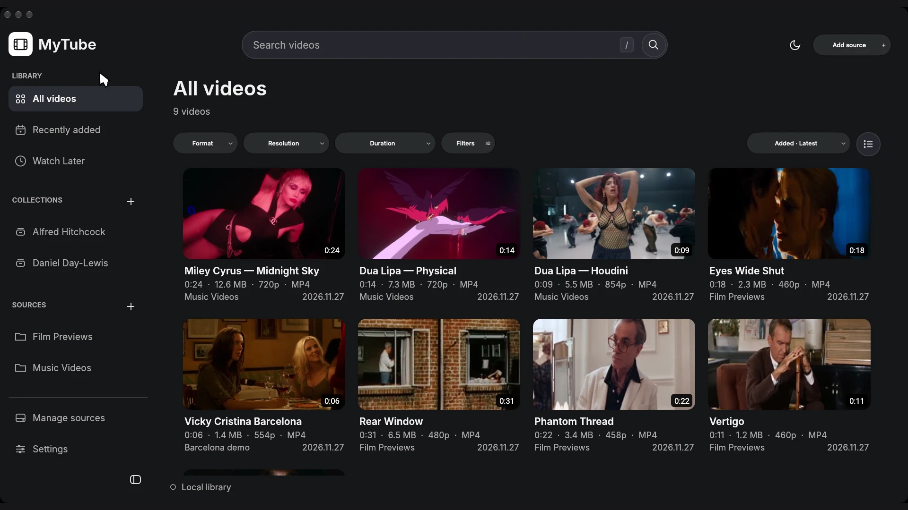

<h1 align="center">MyTube</h1>

<p align="center">A YouTube-style home for the videos on your device. Fast and just about 20 MB to download.</p>

<p align="center">
  <a href="#macos"></a>
  <a href="#linux"></a>
  <a href="#windows"></a>
</p>

<p align="center">
  <a href="#install">Quick install</a> · <a href="docs/guide.md">Features</a>
</p>

[](docs/media/film-and-music/walkthrough.mp4)

## Features

- Play local videos at source quality with [mpv](https://mpv.io/) and resume where you left off.
- Search across folders and drives, filter by resolution or duration, and hover over thumbnails to preview clips.
- Pull up on the timeline to find a shot in the filmstrip, or jump straight to an embedded chapter.
- Save videos to Watch Later, organize them into collections, and revisit recent plays with optional local history.
- Let your playlist autoplay while you browse in the mini player.
- Float a video over other apps with picture-in-picture, or switch to music mode to listen.
- Load matching local subtitles or search OpenSubtitles, then show two tracks at once and adjust their timing.
- Tune mpv with a ten-band equalizer, saved audio and video filters, and local Lua scripts.
- Choose from six looks across YouTube, Liquid Glass, and Glass UI (Opaque), each in light and dark.

## Install

```sh
curl -fsSL https://raw.githubusercontent.com/mo1ein/mytube/v1.0.1/packaging/install.sh -o install-mytube.sh && sh install-mytube.sh
```

### First launch

> On first launch, MyTube looks for videos on mounted local drives. To choose exactly what appears, open **Manage sources** and add a folder or turn off automatic scanning. The catalog, previews, and playback stay local. Setup downloads dependencies, and you can opt to search OpenSubtitles from the player.

