# MyTube features

## Table of contents

- [Browse](#browse-your-library)
- [Organize](#organize-files)
- [Watch](#watch-and-seek)
- [Customize](#customize-the-player)
- [Shortcuts](#keyboard-shortcuts)

## Browse your library

MyTube opens your saved catalog and checks mounted local drives in the background, starting with common media folders. Automatic scans skip system caches, virtual filesystems, and network volumes. A successful scan is reused for 15 minutes. Entries from disconnected drives stay visible.

Open **Manage sources** to add or stop scanning a folder or drive, exclude locations, or turn automatic scanning off. Pause or resume a scan, or choose **Refresh** to check immediately. MyTube verifies a video stream before listing a file and rechecks ambiguous entries from older catalogs after upgrading.

### Search across sources

From **All videos**, search for `Dua Lipa` to find *Houdini* and *Physical* in the sample library.

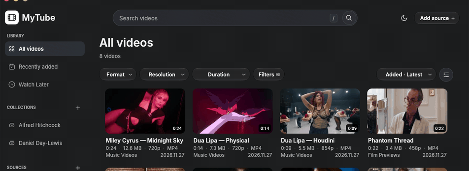

### Format, resolution, and duration

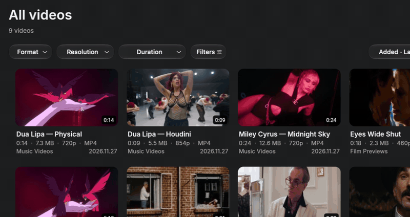
### Advanced filters

To find *Houdini* among those results, open **Filters**, enter `Houdini` in **File name**, then choose **Apply filters**. You can also match a folder, file type, codec, minimum size, or date added, created, or modified. Enter custom duration limits in seconds and resolution limits in pixels.

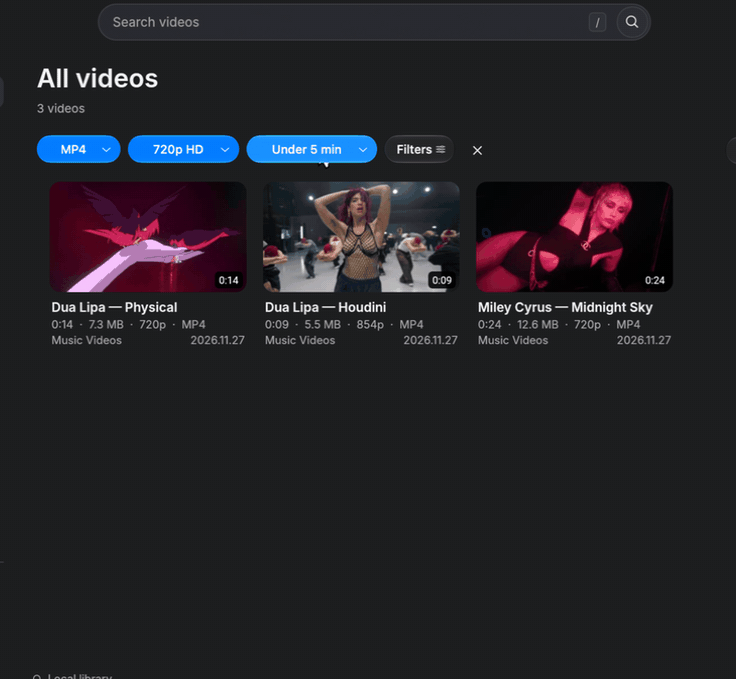
### Hover previews

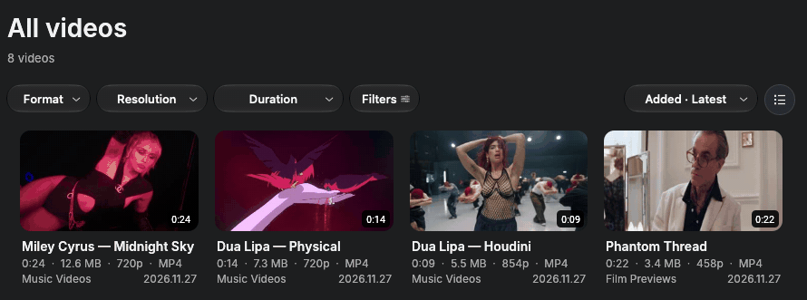

## Organize files

### Watch Later and collections

- **Save for later.** Hover over a thumbnail and click its clock. Open **Watch Later** in the sidebar to find it again.
- **Make a collection.** Hold `⌘` on macOS or `Ctrl` on Windows and Linux and click the videos you want. Right-click the selection, choose **Add to collection → New collection…**, enter a name, then click **Create collection**. Open it in the sidebar. Your files stay in their original folders. To change memberships later, use the checkboxes in **Video details**.

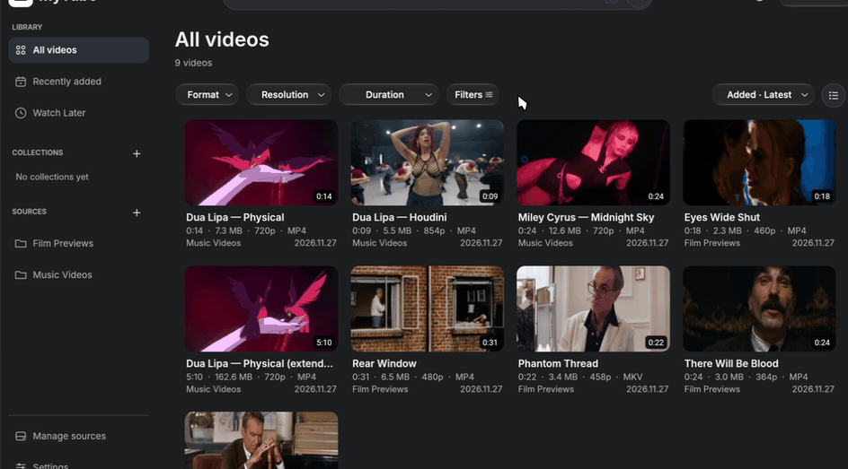
### Copy, move, or delete files

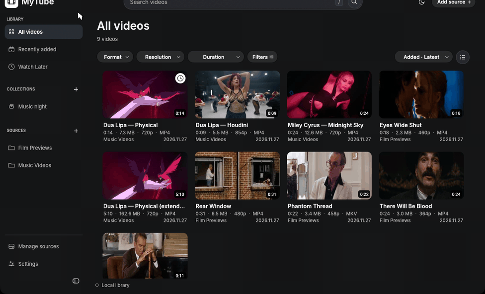

Choose **Delete… → Move to Trash** for recoverable removal. **Delete Permanently** asks for a separate confirmation. To find a video on disk, right-click it and choose **Open containing folder**.

## Watch and seek

### Mini player

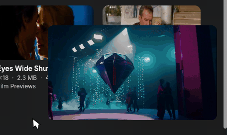

MyTube plays videos at source quality, keeps the current window size when you open a video or advance the playlist, and resumes a reopened video at its saved position. For a separate floating picture-in-picture window, open **Playback** and choose how the library window behaves.

### Filmstrip seeking

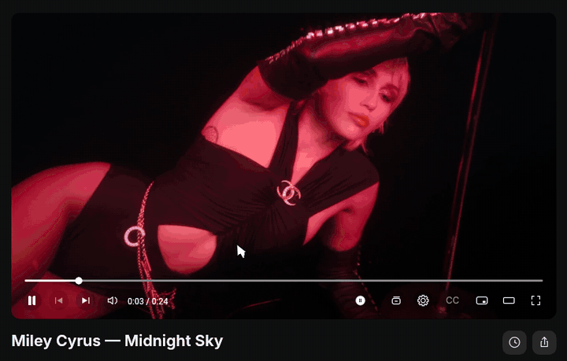
### Playlist and chapters

In **Playlist**, click a thumbnail or title to play another video from your current library results. The play icon beside the folder name marks the current video.

Switch to **Chapters** to see the current video’s chapter titles and start times. The current chapter is highlighted. Click a row to jump there. Videos without embedded chapters show **No chapters in this video**.

<table>
  <tr>
    <td>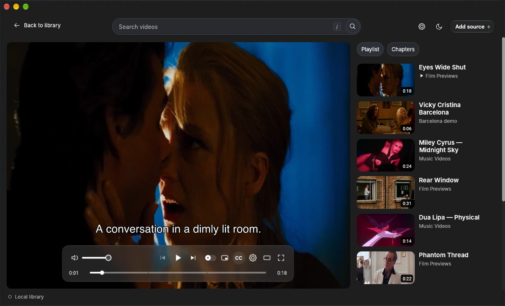</td>
    <td><a href="media/film-and-music/vicky-cristina-barcelona-chapters.mp4">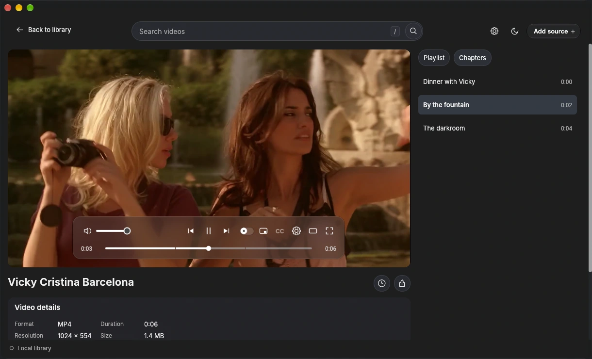</a></td>
  </tr>
</table>

Scroll below the player for details, **Watch Later**, and **Share**. The share menu can copy the path or open the containing folder. On macOS, Share opens the system share sheet, and Now Playing offers play, pause, seek, and previous or next controls.

## Customize the player

During playback, click the gear at the upper right to open settings beside the video. In the library, choose **Settings** in the sidebar. The shortcut is `Cmd+,` on macOS or `Ctrl+,` on Windows and Linux.

In macOS Liquid Glass, select the paintbrush for **General** or the waveform for **Audio**. **Subtitles**, **Controls**, **Tools**, **Inspector**, **Filters**, and **Plugins** sit just below the icons.

[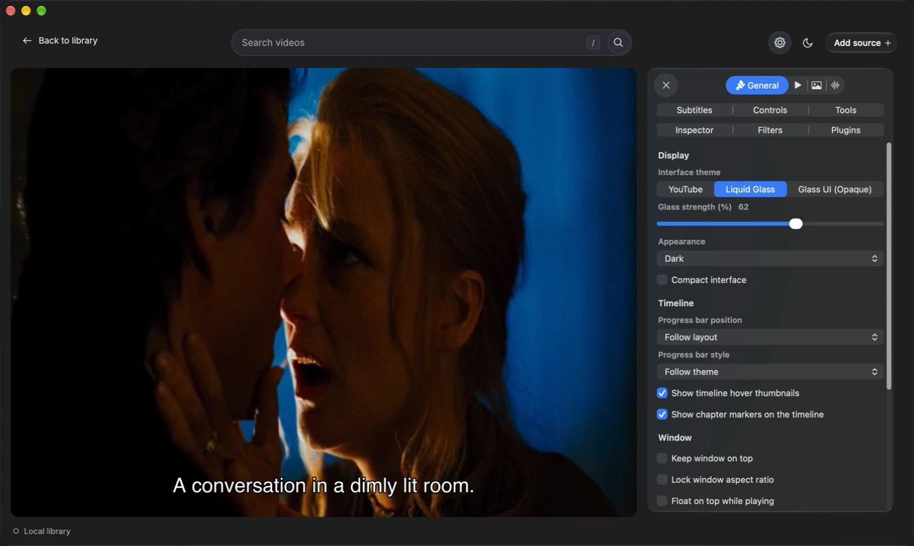](media/film-and-music/customize.webp)

| Two subtitle tracks | Audio equalizer |
| --- | --- |
| [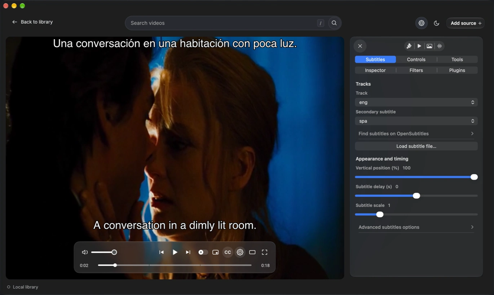](media/film-and-music/dual-subtitles.webp) | [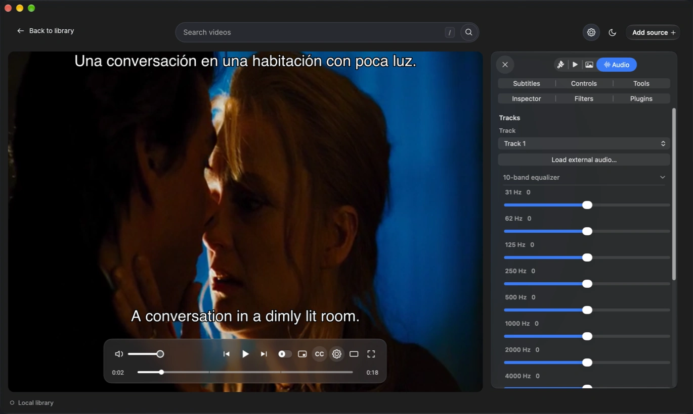](media/film-and-music/equalizer.webp) |

### Themes

Compare all six looks on macOS. Choose a screenshot to see it full size, or choose **System** in MyTube to follow your device’s light or dark appearance.

| Style | Light | Dark |
| --- | --- | --- |
| **YouTube** | [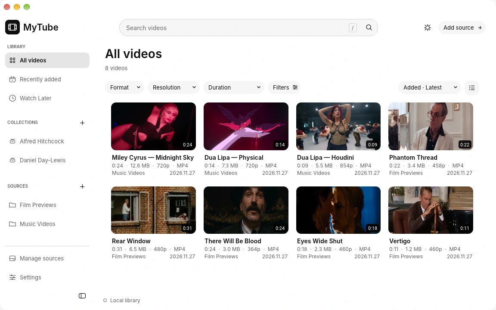](media/film-and-music/youtube-light-library.webp) | [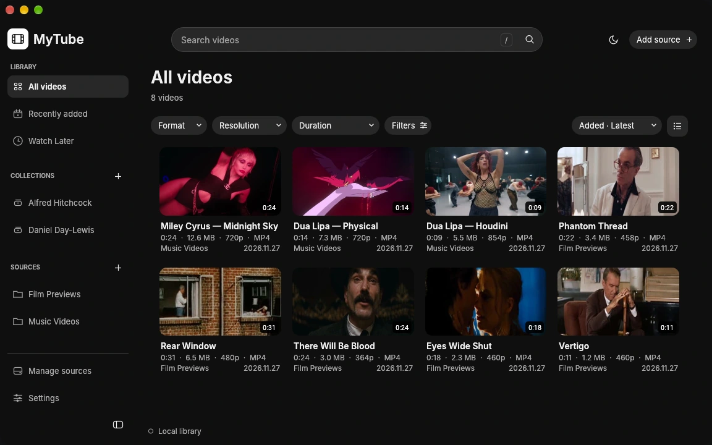](media/film-and-music/youtube-library.webp) |
| **Liquid Glass** | [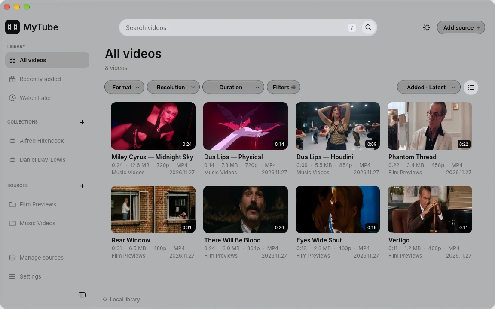](media/film-and-music/liquid-glass-library.webp) | [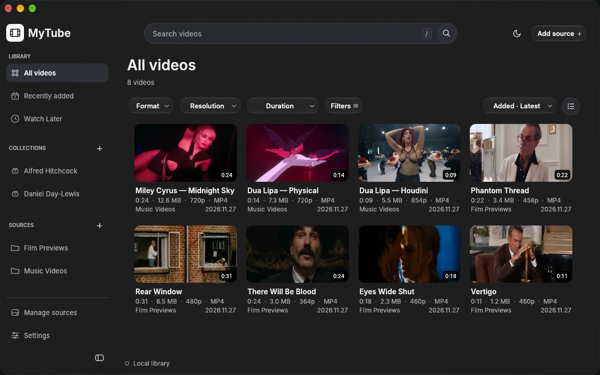](media/film-and-music/liquid-glass-dark-library.webp) |
| **Glass UI (Opaque)** | [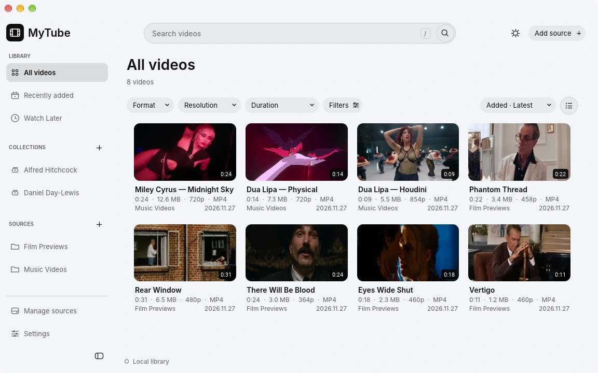](media/film-and-music/opaque-glass-light-library.webp) | [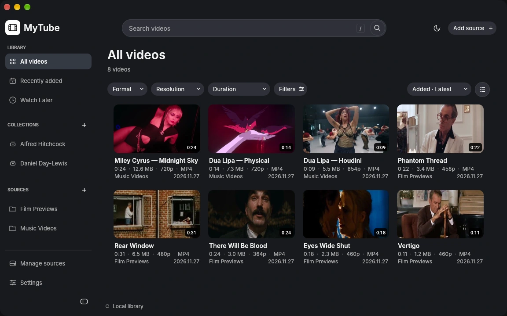](media/film-and-music/opaque-glass-library.webp) |

## Keyboard shortcuts

Use the column for your operating system. On a Mac, `⌘` means Command and `⌫` is the key labeled **Delete**. Single letters such as `F` work on their own. While you type in a text field, the field receives your keystrokes.

[Search and library](#search-and-library) · [Player](#player) · [Menus and dialogs](#menus-and-dialogs) · [Customize shortcuts](#customize-shortcuts)

### Search and library

| Action | macOS | Windows | Linux |
| --- | --- | --- | --- |
| Focus the search field | `⌘+F` or `/` | `Ctrl+F` or `/` | `Ctrl+F` or `/` |
| Highlight the previous or next search suggestion | `↑` / `↓` | `↑` / `↓` | `↑` / `↓` |
| Submit the search, using the highlighted suggestion if present | `Return` | `Enter` | `Enter` |
| Leave the search field and dismiss suggestions | `Esc` | `Esc` | `Esc` |
| Move through videos in the grid or list | Arrow keys | Arrow keys | Arrow keys |
| Play the video selected with the arrow keys | `Return` | `Enter` | `Enter` |
| Copy highlighted text, the selected library files’ paths, or the current main-player video’s path | `⌘+C` | `Ctrl+C` | `Ctrl+C` |
| Open the delete dialog for the selected files | `⌫`, `⌘+⌫`, or Forward Delete | `Delete` | `Delete` |

The slash shortcut works outside text fields. In the grid, left and right move one video and up and down move one row. Highlighted text takes priority when copying. The delete dialog opens with **Cancel** focused.

#### Selection and sizing

| Action | macOS | Windows | Linux |
| --- | --- | --- | --- |
| Toggle one video in the selection | `⌘` + click | `Ctrl` + click | `Ctrl` + click |
| Select the range from the anchor video to the one you click | `Shift` + click | `Shift` + click | `Shift` + click |
| Add that range to your existing selection | `⌘+Shift` + click | `Ctrl+Shift` + click | `Ctrl+Shift` + click |
| Add videos inside a rectangle | `Shift` + drag | `Shift` + drag | `Shift` + drag |
| Toggle videos inside a rectangle | `⌘` + drag | `Ctrl` + drag | `Ctrl` + drag |
| Cancel a selection drag or leave two-finger selection mode | `Esc` | `Esc` | `Esc` |
| Enlarge grid thumbnails or list rows | `⌘+=` or `⌘++` | `Ctrl+=` or `Ctrl++` | `Ctrl+=` or `Ctrl++` |
| Shrink grid thumbnails or list rows | `⌘+-` | `Ctrl+-` | `Ctrl+-` |
| Resize items with the pointer over the library | `⌘` + scroll | `Ctrl` + scroll | `Ctrl` + scroll |
| Open a video’s context menu | `Control` + click or right-click | Right-click | Right-click |

Start a selection rectangle in empty space. Click empty space to clear the selection. Ranges follow the library’s current sort order. On macOS, MyTube also accepts `Control` for the sizing shortcuts.

On supported touchscreens, pan across videos with two fingers. On a trackpad, start with a horizontal two-finger swipe. Start on an unselected video to add items or on a selected video to remove them. Click individual videos to toggle them, then choose **Done** or press `Esc`.

### Player

| Action | macOS | Windows | Linux |
| --- | --- | --- | --- |
| Play or pause | `Space` or `K` | `Space` or `K` | `Space` or `K` |
| Seek backward / forward by the configured interval (default 5 seconds) | `←` / `→` | `←` / `→` | `←` / `→` |
| Seek backward / forward 10 seconds | `J` / `L` | `J` / `L` | `J` / `L` |
| Step backward / forward one frame | `,` / `.` | `,` / `.` | `,` / `.` |
| Play the previous / next video in the current playlist | `↑` / `↓` | `↑` / `↓` | `↑` / `↓` |
| Mute or unmute | `M` | `M` | `M` |
| Toggle captions when a subtitle track is available | `C` | `C` | `C` |
| Enter or leave fullscreen | `F` | `F` | `F` |
| Toggle theater mode outside fullscreen | `T` | `T` | `T` |
| Switch a playing or paused video between the main player and mini player | `I` | `I` | `I` |

The 5-second and 10-second seek keys also work with the pointer over the mini player. To change the arrow-key interval, open **Settings → Playback → Seeking and volume → Arrow key seek (seconds)** and choose 1–120 seconds. An arrow-key seek briefly shows the destination time over the video.

#### Timeline, filmstrip, and panels

| When | Action | macOS | Windows | Linux |
| --- | --- | --- | --- | --- |
| Timeline focused | Jump to the beginning / end | `Home` / `End` | `Home` / `End` | `Home` / `End` |
| Filmstrip open | Play from the selected frame | `Return` | `Enter` | `Enter` |
| Filmstrip open | Cancel and return to the original position | `Esc` | `Esc` | `Esc` |
| Filmstrip open | Switch to the previous / next playlist video | `↑` / `↓` | `↑` / `↓` | `↑` / `↓` |
| **Inline Bottom** volume slider focused | Lower / raise volume | `←` / `→` | `←` / `→` | `←` / `→` |
| **Playlist and chapters** panel open | Close the panel | `Esc` | `Esc` | `Esc` |
| Fullscreen with the filmstrip and panels closed | Return to windowed playback | `Esc` | `Esc` | `Esc` |

On a Mac keyboard without dedicated Home, End, or Forward Delete keys, their equivalents are `Fn+←`, `Fn+→`, and `Fn+⌫`. [Apple’s keyboard reference](https://support.apple.com/en-us/102650)

### Menus and dialogs

| Action | macOS | Windows | Linux |
| --- | --- | --- | --- |
| Move focus to the next / previous control | `Tab` / `Shift+Tab` | `Tab` / `Shift+Tab` | `Tab` / `Shift+Tab` |
| Highlight the previous / next enabled context-menu action | `↑` / `↓` | `↑` / `↓` | `↑` / `↓` |
| Choose the highlighted menu command | `Return` | `Enter` | `Enter` |
| Activate a focused dialog button | `Return` or `Space` | `Enter` or `Space` | `Enter` or `Space` |
| Move to the previous / next button in the delete dialog | `←` / `→` | `←` / `→` | `←` / `→` |
| Create a collection after typing a valid name | `Return` | `Enter` | `Enter` |
| Dismiss the active menu or dialog | `Esc` | `Esc` | `Esc` |

In MyTube’s in-app menus and delete dialog, `Tab` moves forward and `Shift+Tab` moves back through enabled choices.

### Customize shortcuts

| Action | macOS | Windows | Linux |
| --- | --- | --- | --- |
| Open or close player settings | `⌘+,` | `Ctrl+,` | `Ctrl+,` |
| Close a separate settings window while it has focus | `⌘+W` | `Ctrl+W` | `Ctrl+W` |
| Change the focused YouTube settings category in a vertical list | `↑` / `↓` | `↑` / `↓` | `↑` / `↓` |
| Change the focused YouTube settings category in a horizontal row | `←` / `→` | `←` / `→` | `←` / `→` |
| Cancel recording a new shortcut | `Esc` | `Esc` | `Esc` |

Open **Settings → Controls → Keyboard shortcuts**, select the binding beside a player action, then press the new key combination. MyTube flags conflicts with another player binding or a reserved window or library shortcut. Choose **Restore default keyboard shortcuts** to reset the player bindings.

